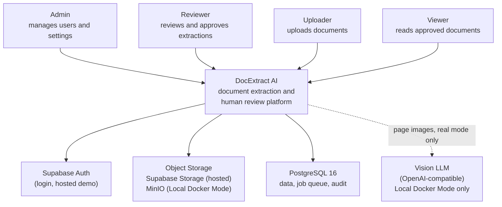
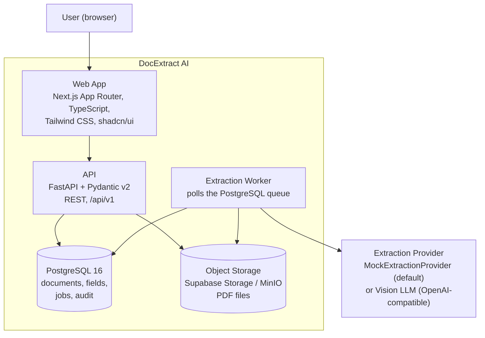

# DocExtract AI

DocExtract AI is an AI-powered document extraction and human review platform: it turns messy business PDFs (invoices, RFPs, contracts, bills of lading) into structured, reviewed, exportable data.


> **Current status: Phase 1 — documentation and structural foundation.**
> This repository currently contains the product contract, architecture documentation, and project scaffolding only. No application code exists yet. See [docs/phase-plan.md](docs/phase-plan.md).

## Live Demo

**URL:** [LIVE DEMO URL - TO BE ADDED] *(public deployment lands in Phase 11)*

| Role | Email | Password |
| --- | --- | --- |
| Admin | admin@demo.docextract.ai | DemoAdmin123! |
| Reviewer | reviewer@demo.docextract.ai | DemoReviewer123! |
| Viewer | viewer@demo.docextract.ai | DemoViewer123! |

**Note:** The demo uses synthetic data and **Mock Mode** (no real AI calls) by default. Every page is labeled "Demo Mode".

## What is DocExtract AI?

Business documents arrive as PDFs, not as clean data. Someone has to open each invoice, contract, or bill of lading, read the fields, and retype them into a spreadsheet or an internal system. This manual work is slow, error-prone, and leaves no record of who entered or changed what.

DocExtract AI automates the first pass. A user uploads a PDF, a pipeline extracts structured fields and tables, detects the document type, and attaches a confidence score to every field. Fields the system is unsure about (confidence below a threshold) are flagged for a human, who sees the original PDF page next to the extracted values, corrects them if needed, and approves the result.

The output is trusted data: approved extractions can be exported as JSON or CSV, and every action — upload, edit, approval, export — is written to an audit trail. The public demo runs in Mock Mode (deterministic, pre-defined results, no AI calls); the same code can run in Local Docker Mode with a real Vision LLM (a language model that reads page images).

## Two Operating Modes

| | Public Online Demo | Local Docker Mode |
| --- | --- | --- |
| **AI provider** | MockExtractionProvider (Mock Mode) | Vision LLM (OpenAI or OpenAI-compatible) |
| **Cost** | $0 (free tiers) | Paid API usage, on your own key |
| **Where it runs** | Vercel + Render + Supabase | Docker Compose on your machine |
| **Use case** | Recruiters and hiring managers via a live link | Technical interviews and screen-share demos |

**Public Online Demo (Mock Mode).** The hosted deployment must be free, fast, always available, and safe. It therefore never calls an external AI provider. The `MockExtractionProvider` returns deterministic, pre-defined results so the demo behaves the same way on every visit. The UI is clearly labeled "Demo Mode". See [docs/demo-mode-explanation.md](docs/demo-mode-explanation.md).

**Local Docker Mode (Real Vision LLM).** The full real pipeline runs on your machine with Docker Compose: PDF pages are rendered to images, sent to a Vision LLM, and the response is validated with Pydantic before being stored. Your API key never leaves your machine. See [docs/local-docker-mode-explanation.md](docs/local-docker-mode-explanation.md).

Switching between providers is a configuration change (`EXTRACTION_MODE`), not a code change — this is the Extraction Provider abstraction.

## Features (Planned MVP)

The following features are defined in the [product contract](docs/product-contract.md) and delivered phase by phase:

- Email/password login with four roles: Admin, Reviewer, Uploader, Viewer (RBAC — role-based access control)
- PDF upload with size (10 MB) and page (20) limits
- Asynchronous extraction pipeline backed by a PostgreSQL job queue
- Light Parser (pypdf) text extraction for native PDFs
- Document type detection: invoice, RFP, contract, bill of lading
- Structured field and table extraction
- Per-field confidence scores with low-confidence flagging
- Review screen: source PDF page beside extracted fields, edit / approve / reject
- Complete audit trail of every change
- Export of approved data as JSON or CSV
- "Demo Mode" labeling in the UI, exports, and audit log
- Local Docker Mode with real Vision LLM extraction

## Architecture Overview

### System Context (C4 Level 1)



ASCII fallback:

```text
 Admin  Reviewer  Uploader  Viewer
   |        |         |        |
   +--------+---------+--------+
                     |
          +---------------------+
          |    DocExtract AI    |
          | (extraction + human |
          |  review platform)   |
          +---------------------+
            |      |       |   (dashed = Local
            |      |       |    Docker Mode only)
   +--------+   +-------+  |   +----------------+
   | Supabase|  | Object|  +-->|   Vision LLM   |
   |  Auth   |  |Storage|      | (OpenAI-comp.) |
   +---------+  +-------+  +-> +----------------+
                       |    |
                 +-----------+
                 | PostgreSQL|
                 | 16 (data, |
                 | job queue)|
                 +-----------+
```

### Container Diagram (C4 Level 2)



ASCII fallback:

```text
                        +------------------+
                        |   User (browser) |
                        +---------+--------+
                                  |
                        +---------v--------+
                        |  Web App         |
                        |  Next.js + TS    |
                        |  (Vercel)        |
                        +---------+--------+
                                  | HTTPS /api/v1
                        +---------v--------+
                        |  API             |
                        |  FastAPI         |
                        |  (Render)        |
                        +---+----------+---+
                            |          |
              +-------------+          +--------------+
              |                                       |
     +--------v--------+                   +----------v----------+
     | Object Storage  |                   | PostgreSQL 16       |
     | Supabase        |                   | data + job queue    |
     | Storage / MinIO |                   | + audit trail       |
     +--------^--------+                   +----------^----------+
              |                                       |
     +--------+---------------------------------------+--------+
     |            Extraction Worker                          |
     |            polls queue, runs pipeline                 |
     +--------------------------+----------------------------+
                                |
                  +-------------v--------------+
                  | Extraction Provider        |
                  | MockExtractionProvider     |
                  | (default) or Vision LLM    |
                  | (Local Docker Mode)        |
                  +----------------------------+
```

## Tech Stack

| Layer | Technology | Purpose |
| --- | --- | --- |
| Frontend | Next.js (App Router), TypeScript (strict), Tailwind CSS, shadcn/ui | Reviewer UI, upload, demo badge |
| Frontend state/data | TanStack Query, React Hook Form + Zod | Server data fetching, form validation |
| PDF viewing | react-pdf (PDF.js) | Show source pages beside extracted fields |
| Backend | Python 3.12, FastAPI, Pydantic v2 | REST API, request/response validation |
| Database access | SQLAlchemy 2.x, Alembic | Models and migrations |
| PDF parsing | pypdf (Light Parser) | Text extraction from native PDFs |
| Page rendering (local only) | pdf2image + Poppler | Render PDF pages to images for the Vision LLM |
| AI (local only) | OpenAI Python SDK | Vision LLM extraction calls |
| Database | PostgreSQL 16 | Data, job queue, audit trail |
| Hosted infra | Supabase (Postgres + Auth + Storage), Vercel, Render | $0 public demo |
| Local infra | Docker Compose, MinIO | Local Docker Mode with real extraction |
| CI/CD | GitHub Actions | Checks and deployment (main / development branches) |

## Getting Started

**Prerequisites:** Git, Python 3.12, Node 20, Docker (with Compose) for Local Docker Mode.

```bash
# 1. Clone
git clone <repository-url>
cd docextract-ai

# 2. Create the folder structure (apps/, docker/, docs/adr/, ...)
bash scripts/init_project.sh        # Windows: powershell scripts/init_project.ps1

# 3. Configure environment
cp .env.example .env                # then edit values (never commit .env)

# 4. Local Docker Mode (real Vision LLM; arrives in Phase 10)
docker compose -f docker/docker-compose.yml up --build
```

For Local Docker Mode, set `EXTRACTION_MODE=openai_vision` and `OPENAI_API_KEY` in `.env` first. See [docs/local-docker-mode-explanation.md](docs/local-docker-mode-explanation.md).

Key environment variables (full list in [.env.example](.env.example)): `EXTRACTION_MODE` (`mock` or `openai_vision`), `CONFIDENCE_THRESHOLD`, `MAX_UPLOAD_MB`, `MAX_PAGES`, `RETENTION_DAYS`, `VISION_MAX_PAGES`.

## Project Structure

```text
docextract-ai/
├── .github/
│   ├── CONTRIBUTING.md             # how to contribute
│   ├── PULL_REQUEST_TEMPLATE.md    # PR checklist
│   └── workflows/                  # CI/CD workflows (Phase 12)
├── apps/
│   ├── api/                        # FastAPI backend (Phase 2+)
│   └── web/                        # Next.js frontend (Phase 9+)
├── docker/                         # Docker Compose setup (Phase 10)
├── docs/
│   ├── adr/                        # architecture decision records
│   ├── architecture.md
│   ├── demo-mode-explanation.md
│   ├── local-docker-mode-explanation.md
│   ├── phase-plan.md
│   └── product-contract.md
├── scripts/
│   ├── init_project.ps1            # Windows structure initializer
│   └── init_project.sh             # Unix structure initializer
├── .editorconfig
├── .env.example
├── .gitignore
├── LICENSE
├── Makefile
└── README.md
```

`apps/`, `docker/`, and `.github/workflows/` are created by `scripts/init_project.sh` and stay empty (`.gitkeep`) until their phase begins.

## Documentation

- [Product Contract](docs/product-contract.md) — requirements, scope, success criteria
- [Architecture](docs/architecture.md) — arc42-based architecture documentation
- [Demo Mode Explanation](docs/demo-mode-explanation.md) — how and why Mock Mode works
- [Local Docker Mode Explanation](docs/local-docker-mode-explanation.md) — the real Vision LLM setup
- Architecture Decision Records:
  - [ADR-001 — Public Demo Uses Mock Mode](docs/adr/ADR-001-public-demo-uses-mock-mode.md)
  - [ADR-002 — Local Docker Uses Real Vision LLM](docs/adr/ADR-002-local-docker-uses-real-vision-llm.md)
  - [ADR-003 — Use pypdf Instead of PyMuPDF](docs/adr/ADR-003-use-pypdf-instead-of-pymupdf.md)
  - [ADR-004 — Use Postgres Queue Instead of Redis](docs/adr/ADR-004-postgres-queue-instead-of-redis.md)
- [Phase Plan](docs/phase-plan.md) — all 12 delivery phases

## Limitations

We state these plainly:

- **No application code exists yet.** Phase 1 delivers documentation and structure only.
- **The public demo does not run real AI.** It uses Mock Mode with deterministic, pre-defined results. Real Vision LLM extraction exists only in Local Docker Mode.
- **Free-tier hosting has limits.** Supabase pauses free projects after about 7 days of low activity; Render spins down free web services after 15 minutes without traffic (first request is then slow). No availability SLA (service level agreement) is provided.
- **Single reviewer at a time.** No real-time collaborative editing.
- **No OCR (optical character recognition) on the hosted demo.** Scanned PDFs are only processed with the Vision LLM in Local Docker Mode.
- **Upload limits:** 10 MB and 20 pages per document; demo documents are deleted after 7 days.
- **Demo credentials are public** and shared by all visitors; the demo data is synthetic.
- **English-language documents only** in the MVP.

## Roadmap

Delivery is split into 12 phases — details and status in [docs/phase-plan.md](docs/phase-plan.md):

01 Product Contract and Architecture Foundation → 02 Backend Skeleton → 03 Database Schema and Migrations → 04 Authentication and RBAC → 05 Storage and Upload Flow → 06 Extraction Engine → 07 Queue and Worker → 08 Review, Audit, Export → 09 Frontend Core → 10 Local Docker Real Vision Setup → 11 Public Online Deployment → 12 Testing and Documentation.

## License

This project is licensed under the [MIT License](LICENSE).

## Acknowledgments

Built on established open-source projects — FastAPI, Next.js, pypdf, Poppler, PostgreSQL, and MinIO — and documented with the arc42 template and the ADR (Architecture Decision Record) practice popularized by Michael Nygard.
