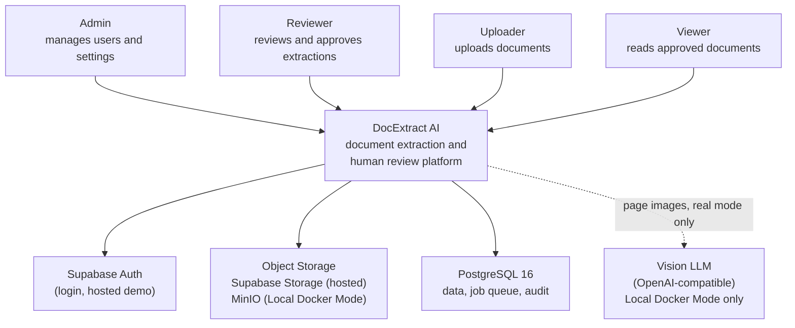
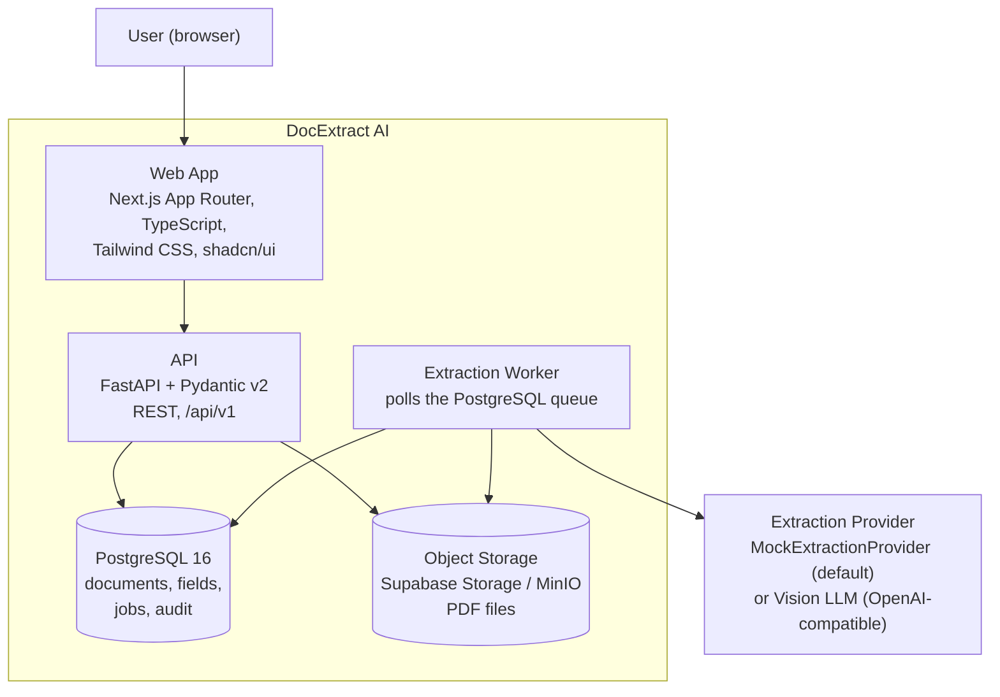
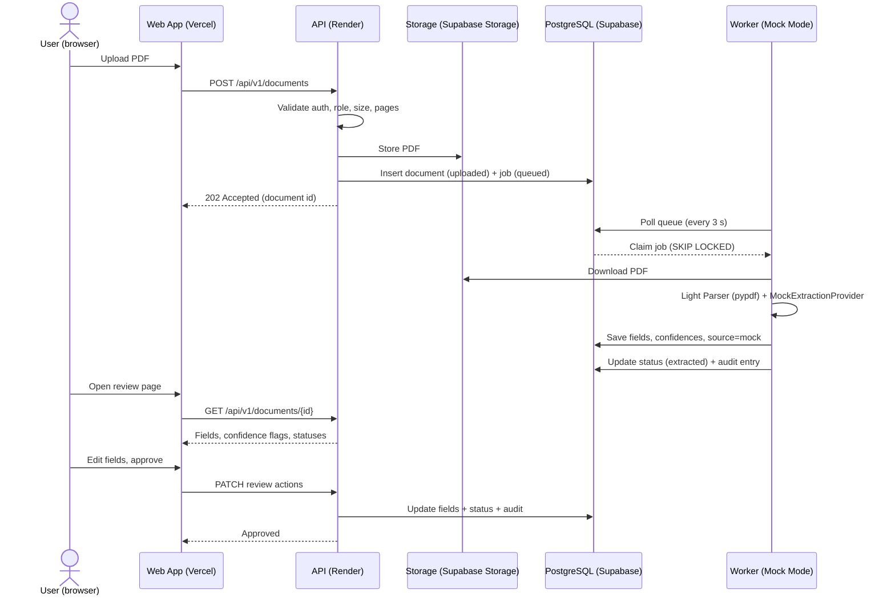
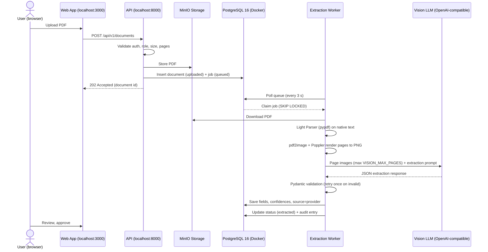
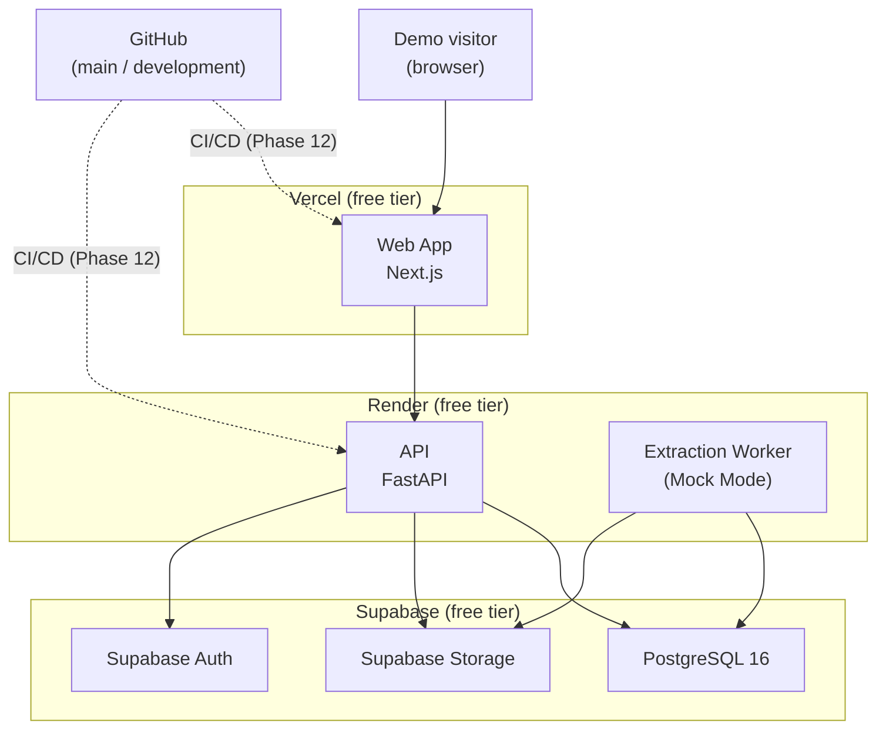
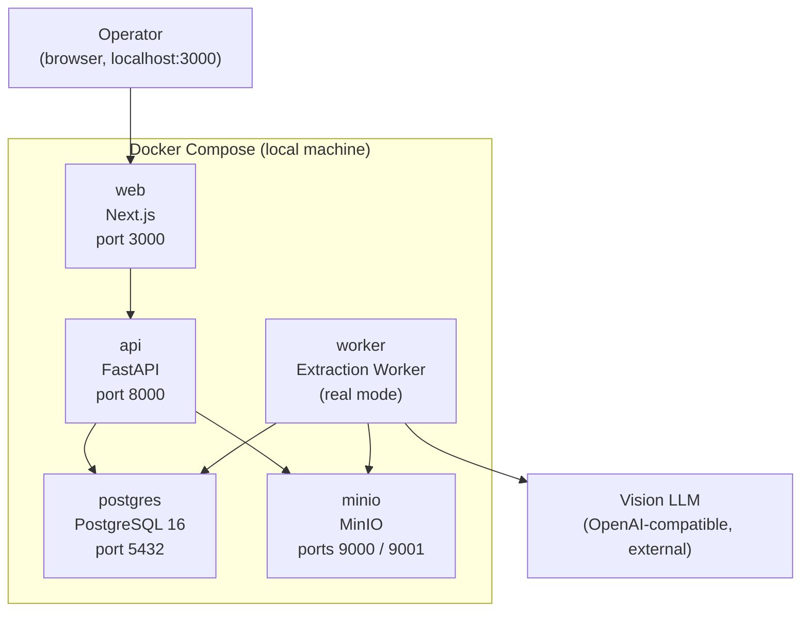

# DocExtract AI — Architecture Documentation

This document follows the arc42 template structure (12 sections). It describes the system as designed in Phase 1; module-level detail is added in later phases as code lands.

## 1. Introduction and Goals

### What is DocExtract AI?

DocExtract AI is an AI-powered document extraction and human review platform. Users upload PDFs (invoices, RFPs, contracts, bills of lading); a pipeline extracts fields and tables, detects the document type, and scores each field's confidence; low-confidence fields are flagged for human review; approved data is exported as JSON or CSV with a complete audit trail.

### Quality Goals

| # | Quality goal | Motivation |
| --- | --- | --- |
| 1 | Determinism of the public demo | The demo must behave identically on every visit, with zero external AI dependency |
| 2 | Portability across operating modes | One code base runs the hosted demo and Local Docker Mode, differing only by environment variables |
| 3 | Security of secrets and documents | No secrets in the browser; documents never leave the hosted demo for a third-party AI |
| 4 | Traceability | Every requirement has an ID, every architectural decision has an ADR, every data change has an audit entry |
| 5 | Maintainability by a solo developer | Small stack surface: one database, one queue mechanism, one provider abstraction |

### Stakeholders

| Stakeholder | Interest |
| --- | --- |
| Mohd Aquib Khan (owner/developer) | Deliverable phases, maintainable code, interview-ready architecture |
| Recruiters / hiring managers (CTO-level) | A live, honest demo that shows senior engineering judgment |
| Demo visitors (Admin / Reviewer / Uploader / Viewer personas) | A working review workflow on synthetic documents |
| Future client operators | Swapping the Extraction Provider and hosting without redesign |

## 2. Architecture Constraints

### Technical Constraints

- Backend: Python 3.12, FastAPI, Pydantic v2, SQLAlchemy 2.x, Alembic.
- Frontend: Next.js App Router, TypeScript strict mode, Tailwind CSS, shadcn/ui, TanStack Query, React Hook Form + Zod, react-pdf (PDF.js) for viewing.
- Database: PostgreSQL 16 (Supabase hosted, or Docker locally).
- Public demo infrastructure: Vercel + Render + Supabase free tiers only ($0 budget).
- Local infrastructure: Docker Compose with MinIO for S3-compatible storage.
- pdf2image + Poppler and the OpenAI Python SDK are local-only (page rendering and Vision LLM calls).

### Organizational Constraints

- One solo developer; delivery in 12 phases (see `docs/phase-plan.md`).
- Branch strategy: `main` (production) and `development` (preview); CI/CD with GitHub Actions.
- All requirements traceable to IDs (FR-xxx / NFR-xxx); all architectural decisions recorded as ADRs.

### Legal Constraints (PyMuPDF AGPL note)

PyMuPDF is licensed under AGPL-3.0 (a commercial license is sold by Artifex Software). Adding it as a Python dependency would embed AGPL-licensed code in this MIT-licensed project, which conflicts with the project constraint "no AGPL dependencies by default" — hence the pypdf decision (ADR-003). MinIO (AGPLv3) and Poppler (GPL) are used only as **separate processes** in Local Docker Mode — they are invoked over the network or as external tools, not linked as libraries, so their code is not distributed inside this repository. This is an engineering risk decision, not legal advice.

## 3. System Scope and Context

### C4 Level 1 — System Context Diagram (Mermaid)



ASCII fallback:

```text
 Admin  Reviewer  Uploader  Viewer
   |        |         |        |
   +--------+---------+--------+
                     |
          +---------------------+
          |    DocExtract AI    |
          | (extraction + human |
          |  review platform)   |
          +---------------------+
            |      |       |   (dashed = Local
            |      |       |    Docker Mode only)
   +--------+   +-------+  |   +----------------+
   | Supabase|  | Object|  +-->|   Vision LLM   |
   |  Auth   |  |Storage|      | (OpenAI-comp.) |
   +---------+  +-------+  +-> +----------------+
                       |    |
                 +-----------+
                 | PostgreSQL|
                 | 16 (data, |
                 | job queue)|
                 +-----------+
```

### Who uses the system?

The four roles defined in the product contract: Admin, Reviewer, Uploader, Viewer — all through the web UI. On the hosted demo these are the three seeded demo personas plus Admin.

### What external systems does it interact with?

- **Supabase Auth** — issues JWTs for login (hosted demo).
- **Object storage** — Supabase Storage (hosted demo) or MinIO (Local Docker Mode) for PDF files.
- **PostgreSQL 16** — data, job queue, and audit trail (Supabase hosted, or Docker local).
- **Vision LLM** — an OpenAI or OpenAI-compatible endpoint, contacted **only** in Local Docker Mode. In Mock Mode there is no AI interaction at all.

## 4. Solution Strategy

| Concern | Decision | Rationale (summary) |
| --- | --- | --- |
| Public demo AI | Mock Mode via MockExtractionProvider | Free, deterministic, safe; no secrets or documents leave the demo (ADR-001) |
| Real AI | Local Docker Mode with Vision LLM on the operator's key | Demonstrates the full pipeline without public cost or key exposure (ADR-002) |
| PDF text extraction | pypdf Light Parser | Permissive BSD license, pure Python, sufficient for native PDFs; PyMuPDF is AGPL (ADR-003) |
| Job queue | PostgreSQL table + row-level locking | One fewer service; queue data stays transactional with domain data (ADR-004) |
| Provider switching | Extraction Provider abstraction behind `EXTRACTION_MODE` | Same code path for mock and real; future clients plug in their provider by configuration |
| Frontend/backend split | Next.js on Vercel, FastAPI on Render | Free tiers for both; clean REST boundary at `/api/v1` |

### Why this tech stack?

Python + FastAPI + Pydantic v2 gives typed request/response validation and OpenAPI docs with little code; SQLAlchemy 2.x plus Alembic gives schema-as-migrations; Next.js App Router with TypeScript strict mode gives one typed frontend framework with free hosting; TanStack Query and React Hook Form + Zod are the standard data-fetching and form-validation pair for review-style screens. All components have free tiers or are open source.

### Why Mock Mode for the public demo?

Cost (AI calls are billed per use), time limits (free-tier hosting enforces request execution limits), privacy (documents must not be sent to a third-party AI without consent), reliability (free AI endpoints are rate-limited and can be down), and determinism (the demo must behave the same on every visit). Full reasoning in ADR-001 and `docs/demo-mode-explanation.md`.

### Why provider abstraction?

The extraction pipeline depends on an interface, not on OpenAI or any vendor. `EXTRACTION_MODE=mock` selects the MockExtractionProvider; `EXTRACTION_MODE=openai_vision` selects the Vision LLM provider. A future client with their own OpenAI-compatible endpoint changes configuration only (NFR-019).

### Why a Postgres queue?

Extraction is asynchronous (seconds to minutes), so it must not run inside the request. A queue table in the same PostgreSQL instance keeps the job and its document row in one database, avoids a second service on constrained free tiers, and uses the standard `SELECT ... FOR UPDATE SKIP LOCKED` claiming pattern. Trade-offs and the Redis migration path are in ADR-004.

## 5. Building Block View

### C4 Level 2 — Container Diagram (Mermaid)



ASCII fallback:

```text
                        +------------------+
                        |   User (browser) |
                        +---------+--------+
                                  |
                        +---------v--------+
                        |  Web App         |
                        |  Next.js + TS    |
                        |  (Vercel)        |
                        +---------+--------+
                                  | HTTPS /api/v1
                        +---------v--------+
                        |  API             |
                        |  FastAPI         |
                        |  (Render)        |
                        +---+----------+---+
                            |          |
              +-------------+          +--------------+
              |                                       |
     +--------v--------+                   +----------v----------+
     | Object Storage  |                   | PostgreSQL 16       |
     | Supabase        |                   | data + job queue    |
     | Storage / MinIO |                   | + audit trail       |
     +--------^--------+                   +----------^----------+
              |                                       |
     +--------+---------------------------------------+--------+
     |            Extraction Worker                          |
     |            polls queue, runs pipeline                 |
     +--------------------------+----------------------------+
                                |
                  +-------------v--------------+
                  | Extraction Provider        |
                  | MockExtractionProvider     |
                  | (default) or Vision LLM    |
                  | (Local Docker Mode)        |
                  +----------------------------+
```

### Container Responsibilities

| Container | Responsibility | Runs on |
| --- | --- | --- |
| Web App | Login, upload, review screen (PDF page beside fields), demo badge, exports | Vercel (hosted) / Docker (local) |
| API | REST `/api/v1`: auth enforcement, RBAC, upload, documents, review, audit, export; enqueues jobs | Render (hosted) / Docker (local) |
| Extraction Worker | Polls the queue, claims jobs, runs the pipeline (Light Parser → provider), writes results, retries failures | Render (hosted) / Docker (local) |
| Database | Documents, extracted fields, job queue, users, audit trail | Supabase Postgres / Docker Postgres 16 |
| Storage | PDF file storage | Supabase Storage / MinIO |
| AI Provider (external) | MockExtractionProvider in-process (default); Vision LLM API in Local Docker Mode | — |

Module-level views (Level 3) are added when the backend skeleton lands in Phase 2.

## 6. Runtime View

### Public Demo Extraction Flow (Mermaid)



ASCII fallback:

```text
User      Web(App)     API       Storage    PostgreSQL   Worker
 | Upload    |           |           |            |          |
 |---------->| POST doc  |           |            |          |
 |           |---------->| validate  |            |          |
 |           |           |---------->| store PDF  |          |
 |           |           |----------------------->| doc+job  |
 |           |<---------| 202 Accepted           |          |
 |           |           |                        | poll/    |
 |           |           |                        |<---------|
 |           |           |                        | claim job|
 |           |           |<-----------------------| download |
 |           |           |---------->| (Light Parser +       |
 |           |           |           |  MockExtraction-      |
 |           |           |           |  Provider, in-process)|
 |           |           |           | save fields, source=  |
 |           |           |           | mock; status=extracted|
 | Open      |           |           |            |          |
 |---------->| GET doc   |           |            |          |
 |           |---------->|-----------|----------->|          |
 |           |<----------| fields + flags         |          |
 | Edit +    |           |            |           |          |
 | approve   |           |            |           |          |
 |---------->| PATCH     |            |           |          |
 |           |---------->| update + audit ------->|          |
 |           |<----------| Approved   |           |          |
```

### Local Docker Real Extraction Flow (Mermaid)



ASCII fallback:

```text
User   Web      API      MinIO    PostgreSQL  Worker   Vision LLM
 |      |        |         |          |         |         |
 |----->| POST   |         |          |         |         |
 |      |------->| validate|          |         |         |
 |      |        |-------->| store PDF|         |         |
 |      |        |------------------->| doc+job |         |
 |      |<-------| 202 Accepted       |         |         |
 |      |        |                    | poll/   |         |
 |      |        |                    |<--------|         |
 |      |        |                    | claim   |         |
 |      |        |<-------------------| download|         |
 |      |        |-------->| (Light Parser,     |         |
 |      |        |         |  pdf2image+Poppler)|         |
 |      |        |         |  page PNGs --------|-------->|
 |      |        |         |                    |<--------|
 |      |        |         |  (Pydantic-validate the JSON) |
 |      |        |         |  save fields + provider source|
 |      |        |         |  status=extracted + audit     |
 | Review/approve ... (same review flow as the public demo)
```

## 7. Deployment View

### Public Demo Deployment (Mermaid)



ASCII fallback:

```text
                 +-------------------+
                 |   Demo visitor    |
                 |     (browser)     |
                 +---------+---------+
                           | HTTPS
                 +---------v---------+
                 |  Vercel (free)    |
                 |  Web App Next.js  |
                 +---------+---------+
                           | /api/v1
                 +---------v---------+        +------------------+
                 |  Render (free)    |        |   Render (free)  |
                 |  API FastAPI      |        |   Worker         |
                 |                   |        |   (Mock Mode)    |
                 +---+----------+----+        +---+---------+----+
                     |          |                 |         |
   +-----------------+          +-----------------+         |
   |                            |                           |
   |   +------------------------+---------------------+     |
   |   |            Supabase (free tier)             |<----+
   |   |  +-----------+ +--------+ +---------------+ |
   +-->|  | PostgreSQL| |  Auth  | |    Storage    | |
       |  |    16     | |(JWTs)  | | (PDF bucket)  | |
       |  +-----------+ +--------+ +---------------+ |
       +---------------------------------------------+

   GitHub (main / development) --CI/CD (Phase 12)--> Vercel & Render
```

Known free-tier behavior: Render spins down free web services after 15 minutes without inbound traffic (first request is slow); Supabase pauses free projects after about 7 days of low activity.

### Local Docker Deployment (Mermaid)



ASCII fallback:

```text
            Operator (browser, http://localhost:3000)
                              |
   +--------------------------v---------------------------+
   |              Docker Compose (local)                  |
   |                                                      |
   |  +-------+   +------+   +--------+   +---------+     |
   |  |  web  |-->| api  |-->|postgres|   |  minio  |     |
   |  | :3000 |   | :8000|   | :5432  |   |:9000/1  |     |
   |  +-------+   +--+---+   +---^----+   +----^----+     |
   |                 |           |             |          |
   |             +---v-----------+-------------+---+      |
   |             |        worker (real mode)         |    |
   |             +--------------------+--------------+    |
   +----------------------------------|-------------------+
                                      |  page images (HTTPS,
                              +-------v-------+  operator's key)
                              |   Vision LLM  |
                              | (OpenAI-comp.)|
                              +---------------+
```

## 8. Cross-Cutting Concerns

### Authentication strategy

Supabase Auth (hosted demo) issues JWTs at login. The FastAPI API validates the JWT (signature via `SUPABASE_JWT_SECRET`) on every request and maps the user to a role; RBAC is enforced per endpoint. Local Docker Mode uses the same JWT contract; the concrete local identity provider is decided in Phase 4 (product contract assumption A-03).

### Error handling strategy

One error envelope across the API: `{"error": {"code", "message", "details"}}` with consistent status mapping — 400 invalid input, 401 unauthenticated, 403 wrong role, 404 not found, 409 invalid state transition (for example approving a rejected document), 413 file too large, 422 schema validation (FastAPI/Pydantic default), 500 internal. Extraction errors are captured on the job record (`failed` status with reason) and never dropped silently.

### Logging strategy

Structured JSON logs from API and worker with a request or job identifier on every line; log level derived from `ENVIRONMENT`; logs never contain document contents or passwords (NFR-015, NFR-017); worker logs a heartbeat every poll cycle.

### Security strategy

Secrets only via environment variables (`.env.example` is the template; `.env` is git-ignored); only `NEXT_PUBLIC_*` values reach the browser (NFR-004); storage objects are private and served through authenticated or signed access; upload validation (size, pages, PDF check); demo data deleted after `RETENTION_DAYS`.

### Configuration management

All configuration is environment-based and validated at startup with Pydantic models; `EXTRACTION_MODE`, `CONFIDENCE_THRESHOLD`, and limits can change between deployments without code changes (NFR-018, NFR-019).

## 9. Architecture Decisions

| ADR | Decision | One-line summary |
| --- | --- | --- |
| [ADR-001](adr/ADR-001-public-demo-uses-mock-mode.md) | Public demo uses Mock Mode | The hosted demo runs the deterministic MockExtractionProvider: free, safe, and always available |
| [ADR-002](adr/ADR-002-local-docker-uses-real-vision-llm.md) | Local Docker uses real Vision LLM | Real extraction runs only locally in Docker, on the operator's own API key |
| [ADR-003](adr/ADR-003-use-pypdf-instead-of-pymupdf.md) | Use pypdf instead of PyMuPDF | pypdf's permissive BSD license avoids embedding AGPL-licensed code in an MIT project |
| [ADR-004](adr/ADR-004-postgres-queue-instead-of-redis.md) | Postgres queue instead of Redis | The job queue is a PostgreSQL table with SKIP LOCKED claiming — one fewer service |

## 10. Quality Requirements

The full catalog is in the product contract (§7). The architecture-relevant subset:

| NFR | Requirement | Architectural tactic |
| --- | --- | --- |
| NFR-001 | Read APIs under 1 s (p95) | Simple REST reads; no AI calls in the request path |
| NFR-004 | No secrets in the browser | `NEXT_PUBLIC_*` convention; service role key stays server-side |
| NFR-009 | No AI dependency for the demo | MockExtractionProvider runs in-process (ADR-001) |
| NFR-018 | One code base, two deployments | Environment-only differences; Docker Compose mirrors hosted topology |
| NFR-019 | Provider swappable by config | Extraction Provider abstraction behind `EXTRACTION_MODE` |
| NFR-015/016 | Structured logs, health check, heartbeat | Logging and health endpoints designed in from Phase 2 |

## 11. Risks and Technical Debts

### Known Risks

- Free-tier behavior: Supabase project pausing and Render spin-down affect demo availability (mitigations in product contract R-01, R-02).
- Vision LLM output drift: mitigated by Pydantic validation and provider abstraction (R-05).
- PostgreSQL queue throughput ceiling under heavy load: accepted with a documented Redis migration path (ADR-004, R-11).

### Accepted Technical Debts

- Polling-based worker (every `WORKER_POLL_SECONDS`) instead of event-driven notifications — simplest reliable mechanism for demo scale.
- No Redis, no pub/sub, no microservices — deliberate scope reduction for a solo developer (out of scope for MVP).
- Mermaid and ASCII diagrams are maintained by hand and can drift — reviewed at each phase boundary.
- Frontend test coverage is deferred to Phase 12 while screens stabilize.
- The local identity provider for Local Docker Mode is undecided until Phase 4 (assumption A-03).

## 12. Glossary

| Term | Definition |
| --- | --- |
| Mock Mode | Operating behavior in which the MockExtractionProvider returns deterministic, pre-defined results; no AI is called |
| Demo Mode | The UI label shown on the public demo deployment, which runs in Mock Mode |
| Local Docker Mode | The Docker Compose environment that runs the full real pipeline on a local machine |
| Extraction Provider | The abstraction behind extraction, selected by `EXTRACTION_MODE` without code changes |
| Vision LLM | A large language model with image input, used to read rendered PDF page images |
| Light Parser | The pypdf-based text extraction step for native PDFs |
| C4 Model | A way to describe architecture in levels: system context (1), containers (2), components (3), code (4) |
| arc42 | A template for practical architecture documentation (12 sections) |
| ADR | Architecture Decision Record — one decision, its context, and its consequences |
| JWT | JSON Web Token — signed authentication token |
| RBAC | Role-based access control |
| SKIP LOCKED | A PostgreSQL row-locking option that lets workers claim queue rows without blocking each other |
| Audit trail | Append-only record of who changed what, when, with before/after values |
| Free tier | A hosting plan that costs $0 within usage limits |
