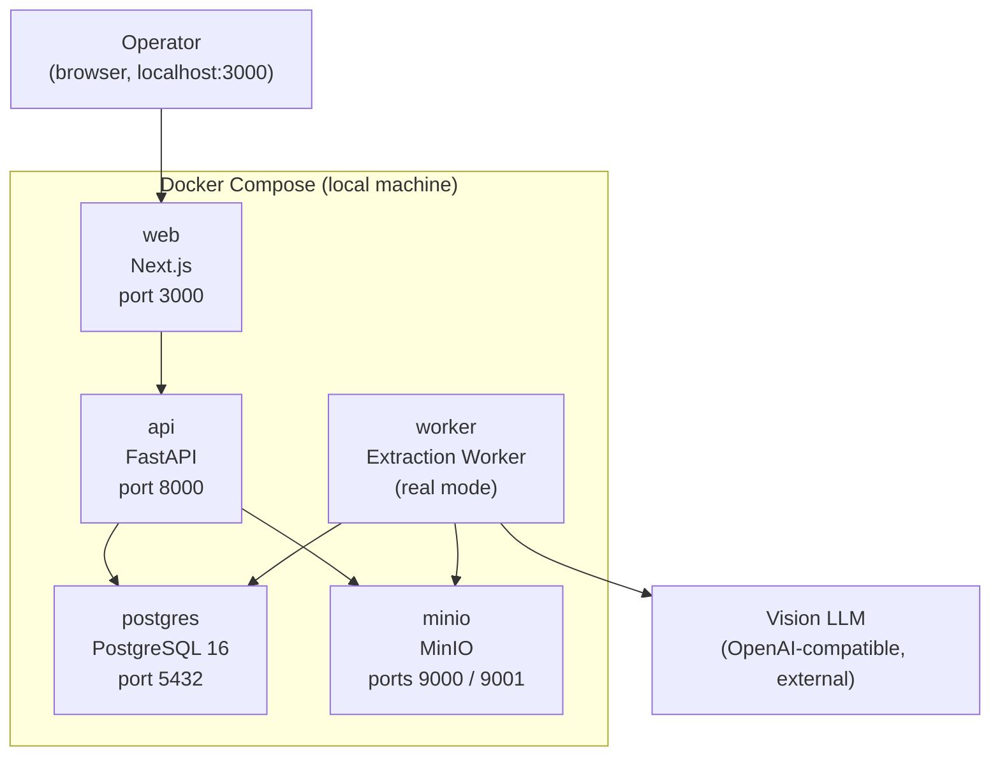

# Local Docker Mode Explanation

This document explains Local Docker Mode — the environment that runs the real Vision LLM extraction pipeline on your own machine.

## 1. What is Local Docker Mode?

Local Docker Mode runs the complete, real DocExtract AI pipeline on your machine with Docker Compose: one command starts the frontend, the API, the extraction worker, PostgreSQL, and MinIO storage. Extraction is performed by a **Vision LLM** — a large language model that reads page images — reached through the OpenAI API or any OpenAI-compatible endpoint, using **your own API key**.

It exists for two situations: technical interviews and screen-share demonstrations, where showing the real pipeline matters (actual PDFs, actual model calls, actual validation), and local development. The public online demo deliberately runs in Mock Mode (see [demo-mode-explanation.md](demo-mode-explanation.md)); Local Docker Mode is where real AI happens.

## 2. What Services Run in Docker?

Docker Compose starts five services on your machine:

| Service | Image / stack | Port | Purpose |
| --- | --- | --- | --- |
| `web` | Next.js frontend | 3000 | The UI you open in the browser |
| `api` | FastAPI backend | 8000 | REST API (`/api/v1`) |
| `worker` | Extraction worker | — | Polls the queue and runs the real pipeline |
| `postgres` | PostgreSQL 16 | 5432 | Data, job queue, audit trail |
| `minio` | MinIO (S3-compatible) | 9000 / 9001 | PDF storage (9001 is the MinIO console) |

The full Compose definition ships in Phase 10 (see [phase-plan.md](phase-plan.md)); the `docker/` directory is prepared by `scripts/init_project.sh` in Phase 1.

## 3. How Does Real Extraction Work?

Step by step, from upload to review:

1. **PDF uploaded to MinIO.** The API validates the file (size, page count, PDF check), stores it in the MinIO `documents` bucket, and inserts a document record plus a queue job in PostgreSQL.
2. **Worker downloads the PDF.** The worker polls the queue every `WORKER_POLL_SECONDS` (default 3), claims the job with row-level locking (`SELECT ... FOR UPDATE SKIP LOCKED`), and fetches the file from MinIO.
3. **pypdf extracts text from native pages.** The Light Parser pulls embedded text from text-based PDF pages — free, fast, deterministic (ADR-003).
4. **pdf2image + Poppler renders scanned pages to PNG.** Pages that need vision (scanned content, layout-dependent fields) are rendered to images using Poppler's rendering utilities through the pdf2image Python wrapper.
5. **Page images sent to the Vision LLM.** Up to `VISION_MAX_PAGES` (default 3) page images are sent to the OpenAI or OpenAI-compatible endpoint, with a timeout of `LLM_TIMEOUT_SECONDS` (default 45) and an output cap of `LLM_MAX_OUTPUT_TOKENS` (default 3000).
6. **Response validated with Pydantic.** The model's JSON response is parsed and validated against the extraction schema; an invalid response is retried and then failed explicitly — bad data is never stored silently.
7. **Fields saved to PostgreSQL.** Extracted fields, tables, per-field confidence scores, and the provider source are written to the database.
8. **Document status updated.** The document moves to `extracted`; fields below `CONFIDENCE_THRESHOLD` (default 0.75) are flagged, and the reviewer edits/approves/rejects exactly as in the demo — every action audited.

## 4. How to Run Local Docker Mode?

Prerequisites: Docker (with Compose) and an OpenAI or OpenAI-compatible API key.

```bash
git clone <repository-url>
cd docextract-ai

cp .env.example .env
# Edit .env:
#   EXTRACTION_MODE=openai_vision
#   OPENAI_API_KEY=<your key>
#   OPENAI_MODEL=<model name>

docker compose -f docker/docker-compose.yml up --build
```

Then open **http://localhost:3000** in your browser. Storage is MinIO on `localhost:9000` (console on `9001`), and the API is reachable on `localhost:8000`.

Handy Makefile aliases: `make docker-up` (same as above), `make docker-down` (stop), `make docker-clean` (stop and delete volumes — erases local data).

## 5. Cost Warning

**Real Vision LLM calls cost money.** Every extraction sends page images to a paid API and is billed by your provider according to the model used and the tokens processed. This project deliberately does not quote prices — check your provider's current pricing page before running.

Cost controls built into the configuration:

- `VISION_MAX_PAGES=3` caps how many page images are sent per document.
- `LLM_MAX_OUTPUT_TOKENS=3000` caps the response size.
- `LLM_TIMEOUT_SECONDS=45` stops requests that hang.
- `EXTRACTION_MODE` defaults to `mock`, so real calls happen only when you explicitly switch them on.

Use real mode only during interviews, screen-shares, and testing. Do not leave the worker running in real mode unattended against a large document set.

## 6. Architecture Diagram



ASCII fallback:

```text
            Operator (browser, http://localhost:3000)
                              |
   +--------------------------v---------------------------+
   |              Docker Compose (local)                  |
   |                                                      |
   |  +-------+   +------+   +--------+   +---------+     |
   |  |  web  |-->| api  |-->|postgres|   |  minio  |     |
   |  | :3000 |   | :8000|   | :5432  |   |:9000/1  |     |
   |  +-------+   +--+---+   +---^----+   +----^----+     |
   |                 |           |             |          |
   |             +---v-----------+-------------+---+      |
   |             |        worker (real mode)         |    |
   |             +--------------------+--------------+    |
   +----------------------------------|-------------------+
                                      |  page images (HTTPS,
                              +-------v-------+  operator's key)
                              |   Vision LLM  |
                              | (OpenAI-comp.)|
                              +---------------+
```
